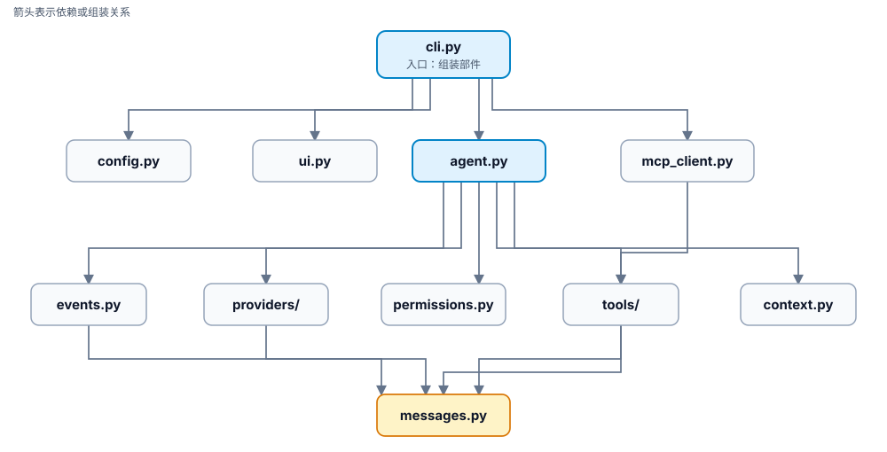
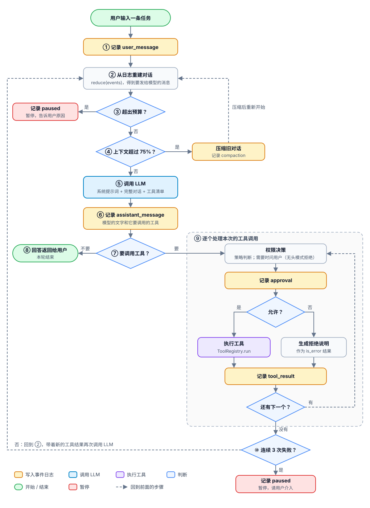
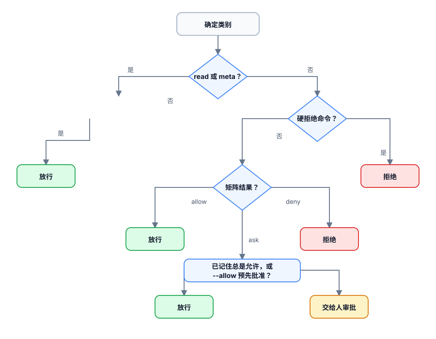

# minicode 代码导读

这份文档带你从头到尾读懂 minicode 的工程代码：每个文件负责什么、关键函数怎么写、为什么这样写，以及各部分是怎样串起来的。

仓库里三份文档的分工：

| 文档 | 回答的问题 |
| --- | --- |
| [文章](https://yishui.pages.dev/#/e077cfd49ac75efabd60dca729248876) | 为什么这样设计：背后的理论和原则 |
| [design.md](./design.md) | 做什么：功能范围、参数、权限矩阵、业务流程的序列图 |
| 本文 | 代码怎么写的：按模块读源码 |

本文的代码都来自源码。为了便于阅读，有些片段做了简化：省略的部分用 `# ...` 标出，带圈数字和部分行尾说明是本文加的注释，个别长语句合并成了一行。完整代码以源文件为准，建议一边读，一边打开对应的源文件对照。

## 目录

- [零、先跑起来](#零先跑起来)
- [一、全局地图](#一全局地图)
- [二、messages.py：全项目的通用语言](#二messagespy全项目的通用语言)
- [三、events.py：会话的记事本](#三eventspy会话的记事本)
- [四、tools/base.py：工具的骨架](#四toolsbasepy工具的骨架)
- [五、agent.py：心脏](#五agentpy心脏)
- [六、permissions.py：门卫](#六permissionspy门卫)
- [七、providers/：翻译官](#七providers翻译官)
- [八、context.py：管理上下文](#八contextpy管理上下文)
- [九、具体的工具](#九具体的工具)
- [十、tools/explore.py：子代理](#十toolsexplorepy子代理)
- [十一、mcp_client.py：接入外部工具](#十一mcp_clientpy接入外部工具)
- [十二、外壳：config.py、cli.py、ui.py](#十二外壳configpyclipyuipy)
- [十三、测试怎么读、怎么写](#十三测试怎么读怎么写)
- [十四、动手练习：加一个新工具](#十四动手练习加一个新工具)
- [十五、常见疑问](#十五常见疑问)

## 零、先跑起来

读代码之前，先看它跑一遍。在仓库根目录执行：

```sh
uv sync
cp -r examples/buggy-calc /tmp/demo
uv run minicode -C /tmp/demo --mode auto-edit \
  --mock-script examples/mock_scripts/fix_buggy_calc.json --task "修复失败的测试"
```

你会看到 Agent 列计划、读文件、跑测试、改代码、再跑测试，最后报告修好了。这里用的是 **Mock 模型**：它不调用任何真实的大模型，而是按 `fix_buggy_calc.json` 这个脚本依次给出回复。但工具是**真实执行的**：文件真的被改了，pytest 也真的运行了。

运行结束后，打开 `/tmp/demo/.minicode/sessions/` 下的 `.jsonl` 文件。这是本次会话的完整记录，读后面的章节时会反复用到它。

## 一、全局地图

### 一句话概括

**minicode = 一个循环 + 几个可替换的部件。** 循环在 `agent.py` 里：调模型 → 模型要用工具就执行 → 把结果交回模型 → 再调模型，直到模型不再要求使用工具。其他文件都是这个循环的部件。

### 模块关系



[查看 Mermaid 源码](./diagrams/module-dependencies.mmd)

### 一次输入的业务流程

用户每输入一次，Agent 就按下图走一轮：先记录，再调 LLM，模型要用工具就逐个执行并记录结果，然后**带着新的工具结果再调一次 LLM**，如此循环，直到模型不再要求使用工具，才把回答返回给用户。图中黄色的节点表示“写入事件日志”，可以对照 `.minicode/sessions/` 下的日志一行行看。



[查看 Mermaid 源码](./diagrams/agent-turn-flow.mmd)

| 步骤 | 做什么 | 代码位置 | 写入的事件 |
| --- | --- | --- | --- |
| 用户输入 | REPL 读到一行，或命令行的 `--task` | `cli.run_repl` / `cli.run_headless` → `Agent.run_turn` | 无 |
| ① | 把用户输入记下来 | `Agent._record` → `SessionLog.append` | `user_message` |
| ② | 从全部事件重建对话、待办清单、用量等 | `Agent.state` → `events.reduce` | 无 |
| ③ | 检查步数、token、费用是否超出预算 | `Agent._check_budget` | 超出时写 `paused` |
| ④ | 估算上下文大小，超过窗口的 75% 就压缩，然后重新开始本轮循环 | `context.needs_compaction` → `Agent.compact` | `compaction` |
| ⑤ | 把系统提示词、完整对话和工具清单发给模型；遇到可重试的错误就退避重试 | `Agent._call_model` → `Provider.complete` | 无 |
| ⑥ | 记下模型的回复：它说的话，以及它要调用的工具 | `run_turn` 中的 `_record` | `assistant_message` |
| ⑦ | 判断模型是否要调用工具（`stop_reason` 为 `tool_use` 且有工具调用） | `run_turn` | 无 |
| ⑧ | 不调用工具：本轮结束，回答交给 CLI 显示 | `TurnResult("done")` → `cli` | 无 |
| ⑨ | 逐个处理工具调用：权限决策 → 记录审批 → 执行工具或生成拒绝说明 → 记录结果 | `Agent._execute`、`Agent._approve`、`PermissionPolicy.decide`、`ToolRegistry.run` | `approval`、`tool_result`（`update_todos` 还会写 `todos_updated`） |
| ⑩ | 连续 3 次工具失败（审批拒绝不计入）就暂停，否则回到 ② | `run_turn`、`MAX_CONSECUTIVE_FAILURES` | 暂停时写 `paused` |

**工具结果是怎么交给 LLM 的？** 第 ⑨ 步把结果写成 `tool_result` 事件后，流程回到第 ② 步。`reduce` 重建出的对话末尾就多了这条结果，第 ⑤ 步再调用 LLM 时，它就随完整对话一起发了出去。整个过程中没有专门“发送结果”的代码，靠的就是“写日志 → 重建对话 → 发送完整对话”这个循环。

以修复 buggy-calc 为例，这个循环一共转了 8 圈：前 7 圈模型依次调用 `update_todos`、`list_files`、`read_file`、`run_command`（测试失败）、`edit_file`、`run_command`（测试通过）、`update_todos`，第 8 圈模型不再调用工具，直接给出总结。

图里省略了两个细节：模型调用了不存在的工具时，跳过权限决策，直接记录一条“未知工具”的错误结果；按 Ctrl-C 中断时怎样补齐结果，见 [design.md 第 7 节的中断处理表](./design.md#中断处理)。逐条消息的时序可以看 [design.md 第 7 节的序列图](./design.md#序列图一次输入的完整一轮)。

### 文件一览

| 文件 | 职责 | 打个比方 | 行数 |
| --- | --- | --- | --- |
| [messages.py](../src/minicode/messages.py) | 定义消息、工具调用、工具结果等数据类型 | 通用语言 | 102 |
| [events.py](../src/minicode/events.py) | 事件日志，以及从日志推算当前状态 | 记事本 | 186 |
| [agent.py](../src/minicode/agent.py) | Agent 主循环：调模型、审批、执行工具、记录 | 心脏 | 282 |
| [tools/](../src/minicode/tools) | 工具的抽象、注册表，以及 7 个内置工具和 explore 子代理 | 手 | 约 700 |
| [permissions.py](../src/minicode/permissions.py) | 路径守卫、命令分类、审批决策 | 门卫 | 341 |
| [providers/](../src/minicode/providers) | 把内部消息翻译成各家模型 API 的格式，再翻译回来 | 翻译官 | 约 490 |
| [context.py](../src/minicode/context.py) | 系统提示词、token 估算、自动压缩 | 管家 | 163 |
| [mcp_client.py](../src/minicode/mcp_client.py) | 连接 MCP 服务器，把外部工具接进来 | 转接头 | 244 |
| [config.py](../src/minicode/config.py) | 读配置、模型参数表 | 设置面板 | 156 |
| [cli.py](../src/minicode/cli.py)、[ui.py](../src/minicode/ui.py) | 命令行入口、终端显示、交互审批 | 外壳 | 332 |

### 推荐阅读顺序

先读数据，再读流程，最后读外围：

1. `messages.py`：先认识贯穿全项目的几种数据。
2. `events.py`：了解会话状态存在哪里。
3. `tools/base.py`：了解“工具”长什么样。
4. `agent.py`：把前三者串起来的主循环，这是全项目的核心。
5. `permissions.py`、`providers/`、`context.py`：主循环依赖的三个部件。
6. 具体工具、explore、MCP、cli：按兴趣阅读。

## 二、messages.py：全项目的通用语言

Anthropic 和 OpenAI 的 API 对“消息”“工具调用”的格式规定各不相同。如果 Agent 循环直接使用某一家的格式，换模型时就得改遍整个项目。所以 minicode 自己定义了一套**中立的**数据类型，项目内部只用这一套；和各家 API 打交道时，由 `providers/` 负责来回翻译。

所有类型都用 pydantic 定义：

| 类型 | 含义 | 关键字段 |
| --- | --- | --- |
| `TextBlock` | 一段文字 | `text` |
| `ToolCall` | 模型发出的一次工具调用（“申请单”） | `id`、`name`、`arguments`（字典） |
| `ToolResult` | 工具执行的结果（“回执”） | `call_id`、`content`、`is_error` |
| `Message` | 一条消息，由若干块组成 | `role`（user 或 assistant）、`blocks` |
| `ModelResponse` | 一次模型调用的返回 | `blocks`、`stop_reason`、`usage` |
| `Usage` | token 用量，支持用 `+` 累加 | `input_tokens`、`output_tokens`、`cache_read_tokens` |
| `ToolSpec` | 发给模型的工具说明书 | `name`、`description`、`input_schema` |

几个值得注意的地方：

- **工具结果放在 user 消息里。** 一条 assistant 消息可以同时包含文字和多个 `ToolCall`；对应的 `ToolResult` 则放在紧随其后的 user 消息里，靠 `call_id` 和 `ToolCall.id` 配对。这和 Anthropic API 的规定一致；OpenAI 的格式不同，由适配器转换。
- **用 `type` 字段区分块的种类。** `Block = Annotated[TextBlock | ToolCall | ToolResult, Field(discriminator="type")]` 告诉 pydantic：从 JSON 读回时，看 `type` 字段决定构造哪个类。这样事件日志里存的块，读回来时能还原成正确的类型。
- **`stop_reason` 只有 4 种**：`end_turn`（说完了）、`tool_use`（要用工具）、`max_tokens`（输出被截断）、`refusal`（拒绝回答）。各家 API 的说法五花八门，适配器负责映射到这 4 种。

## 三、events.py：会话的记事本

### 会话就是一份只追加的日志

minicode 不在内存里单独维护一份对话列表。会话中发生的每件事，都作为一条**事件**追加到 `<工作区>/.minicode/sessions/<会话 ID>.jsonl`，每行一条 JSON。下面是修复 buggy-calc 时真实日志中的 3 行：

```json
{"type": "assistant_message", "ts": "...", "blocks": [{"type": "text", "text": "按 AGENTS.md 的说明运行测试，确认是哪个用例失败。"}, {"type": "tool_call", "id": "mock_5584_4", "name": "run_command", "arguments": {"command": "python -m pytest -q"}}], "stop_reason": "tool_use", "usage": {"input_tokens": 1483, "output_tokens": 16, "cache_read_tokens": 0}}
{"type": "approval", "ts": "...", "call_id": "mock_5584_4", "tool": "run_command", "decision": "allow", "by": "policy", "reason": ""}
{"type": "tool_result", "ts": "...", "call_id": "mock_5584_4", "content": "exit code: 1\n--- stdout ---\n...F …", "is_error": true}
```

依次是：模型说要跑测试（申请单），策略自动放行（审批），测试失败（回执）。

### SessionLog：读写日志

[SessionLog](../src/minicode/events.py) 只有 4 个方法：

| 方法 | 作用 |
| --- | --- |
| `create(workspace, meta)` | 新建会话：生成 ID、创建文件、写入第一条 `session_start` |
| `load(workspace, session_id)` | `--resume` 时读回日志；最后一行如果只写了一半（进程被杀），就丢弃它 |
| `append(event)` | 追加一条事件，**立即 flush 到磁盘** |
| `in_memory()` | 只存在内存里的日志，给 explore 子代理用 |

`append` 每次都立即 flush，是为了保证进程随时被杀，已经发生的事情也不会丢。

### reduce：从日志推算当前状态

[reduce(events)](../src/minicode/events.py) 是一个纯函数：输入全部事件，输出当前状态 `SessionState`。可以把它想成“从银行流水算出当前余额”：

| `SessionState` 字段 | 含义 |
| --- | --- |
| `messages` | 要发给模型的消息列表 |
| `todos` | 最新的待办清单 |
| `usage` | 累计 token 用量 |
| `steps` | 调用过模型的次数 |
| `consecutive_failures` | 连续失败的工具调用数 |
| `last_input_tokens`、`chars_since_last_call` | 估算上下文大小用 |

它逐条扫描事件：`user_message`、`assistant_message`、`tool_result` 变成消息；`todos_updated` 更新清单；`compaction` 把较早的消息替换成摘要；`session_start`、`paused`、`interrupted` 只做记录，不影响状态。

注意 **reduce 不是压缩**。它不删任何内容，也不调用模型，只是把日志“翻译”成状态。

### _MessageBuilder：保证调用和结果配对

模型 API 有一条硬性规定：每个工具调用后面都必须跟着它的结果。`reduce` 内部用 `_MessageBuilder` 拼消息，并守住这条规则：

- 相邻的 user 内容合并成一条消息（例如同一批的多个工具结果）；
- 找不到对应调用的结果，直接丢弃；
- 有调用、没结果（比如进程在执行工具时被杀），就补一条“操作已中断，未执行”的错误结果（`close_dangling`）。

所以无论进程在哪一刻崩溃，`--resume` 后重建出的对话都是合法的。

## 四、tools/base.py：工具的骨架

### 一个工具由什么组成

```python
@dataclass
class Tool:
    name: str                 # 工具名，模型用它来指定调用哪个工具
    description: str          # 写给模型看的使用说明
    input_schema: dict        # 参数的 JSON Schema
    handler: Handler          # 真正干活的 Python 函数
    kind: ToolKind            # read / edit / exec / meta / mcp，权限系统据此判断
```

前三项会变成 `ToolSpec` 发给模型，模型只看得到这三项；`handler` 和 `kind` 留在本地，模型看不到。

`handler` 的签名是统一的：`handler(args: dict, ctx: ToolContext) -> ToolOutput`。

- `args`：模型填的参数。
- `ctx`（`ToolContext`）：执行环境，包括工作区路径、输出长度上限，以及一个 `on_todos` 回调。它提供的 `ctx.resolve(path)` 会经过路径守卫，**所有文件类工具都必须用它解析路径**。
- 返回值 `ToolOutput`：`content`（给模型看的文字）、`is_error`（是否出错）、`usage`（工具内部调用模型产生的用量，目前只有 explore 用到）。

### ToolRegistry：工具的总入口

[ToolRegistry](../src/minicode/tools/base.py) 本质上是一个按名字查找的字典。最重要的是 `run` 方法，模型的每一次工具调用都从这里经过：

```python
def run(self, call: ToolCall, ctx: ToolContext) -> ToolOutput:
    tool = self.tools.get(call.name)
    if tool is None:
        return ToolOutput(f"未知工具：{call.name}。可用工具：{', '.join(self.tools)}", is_error=True)
    error = validate_arguments(tool.input_schema, call.arguments)
    if error:
        return ToolOutput(f"参数错误：{error}", is_error=True)
    try:
        output = tool.handler(call.arguments, ctx)
    except PermissionError as err:
        output = ToolOutput(str(err), is_error=True)
    except Exception as err:  # 工具异常不能打断 Agent 循环，转成错误结果交给模型
        output = ToolOutput(f"工具执行出错：{type(err).__name__}: {err}", is_error=True)
    return ToolOutput(truncate(output.content, ctx.max_output_chars), output.is_error, output.usage)
```

它依次做四件事：找工具 → 校验参数 → 执行 → 截断输出。核心思想是：**不管出什么错，都不抛异常，而是变成一条 `is_error=True` 的结果交给模型**。模型看到“参数错误：缺少必填参数 path”这样的说明，下一次就会改正。

两个辅助函数：

- `validate_arguments`：轻量校验，只检查必填项和顶层参数的类型，够用即可。
- `truncate`：输出超过上限（默认 2 万字符）时，保留开头 70% 和结尾 30%，中间写明省略了多少字符、怎样缩小范围。保留结尾是因为报错信息常常在最后。

`tools/__init__.py` 里的 `builtin_registry()` 会创建一个注册表，并装入 7 个内置工具。

## 五、agent.py：心脏

### 构造：所有部件从外面传进来

```python
Agent(
    provider=...,       # 模型适配器：Anthropic、OpenAI 兼容或 Mock
    registry=...,       # 工具注册表
    log=...,            # 事件日志
    system_prompt=...,  # 系统提示词
    workspace=...,      # 工作区路径
    policy=...,         # 权限策略
    approver=...,       # 审批者：终端里问人，或无头模式下一律拒绝
    events=...,         # 界面回调（AgentEvents）
    config=...,         # 预算等配置（AgentConfig）
    retry=...,          # 重试策略
    sleep=time.sleep,   # 等待函数，测试时换成不等待的版本
)
```

`Agent` 自己不创建任何部件，全部由调用方传入。好处是每个部件都能单独替换：`cli.py` 传入真实的模型和终端界面；测试传入 Mock 模型、静默界面和不等待的 `sleep`；explore 子代理传入只读工具和内存日志。**同一个 `Agent` 类，换一组部件就能用在完全不同的场景里。**

### run_turn：一轮对话

用户每输入一次，`cli.py` 就调用一次 `run_turn`。流程图见第一节的[一次输入的业务流程](#一次输入的业务流程)，完整的序列图见 [design.md 第 7 节](./design.md#序列图一次输入的完整一轮)。这里看去掉了异常处理的简化版：

```python
def run_turn(self, user_text: str) -> TurnResult:
    self._record("user_message", text=user_text)                 # ① 记下用户输入
    steps_at_start = self.state.steps
    while True:
        state = self.state                                       # ② reduce 出当前状态
        paused = self._check_budget(state, steps_at_start)       # ③ 超预算就暂停
        if paused:
            return paused
        # ...（上下文超过窗口 75% 时先压缩，省略）
        response = self._call_model(state)                       # ④ 调模型（带重试）
        self._record("assistant_message", ...)                   # ⑤ 记下模型回复
        if response.stop_reason != "tool_use" or not response.tool_calls:
            return TurnResult("done", text=response.text)        # ⑥ 不用工具了，本轮结束
        for call in response.tool_calls:                         # ⑦ 逐个执行工具
            self._execute(call)
        # ...（连续 3 次工具失败就暂停，省略）
```

几个要点：

- **`self.state` 每次都现算**。它是一个属性，内部就是 `reduce(self.log.events)`。Agent 不保存任何会过期的状态，日志是唯一的事实来源。
- **工具结果交给模型的方式**：`_execute` 把结果写成 `tool_result` 事件；循环回到 ②，`reduce` 重建消息时，这条结果就出现在对话末尾；④ 再次调用模型时，模型就看到了它。整个过程没有一行代码是“专门把结果发给模型”的，靠的就是“写日志 → 重建 → 发送”这个循环。
- **中断处理**（代码中省略了）：调用模型或执行工具时如果按下 Ctrl-C，会为还没有结果的工具调用补上“用户已取消”的结果，再返回 `interrupted`，详见 [design.md 第 7 节的中断处理表](./design.md#中断处理)。

`TurnResult.status` 有 4 种：`done`（完成）、`paused`（超预算或连续失败）、`interrupted`（被中断）、`error`（模型调用出现不可重试的错误）。

### _call_model：调模型，失败就重试

```python
def _call_model(self, state: SessionState) -> ModelResponse:
    attempt = 0
    while True:
        try:
            return self.provider.complete(
                system=self.system_prompt,
                messages=state.messages,
                tools=self.registry.specs(),  # 工具定义始终全部发送，模式只在执行时生效
                max_tokens=self.config.max_output_tokens,
                on_text=self.events.on_text,
            )
        except RetryableError as err:
            if attempt >= self.retry.max_retries:
                raise
            delay = self.retry.delay(attempt, err.retry_after)
            attempt += 1
            # ...（提示用户正在重试）
            self.sleep(delay)
```

- 只有 `RetryableError`（429、5xx、超时、连接失败）才重试；认证失败这类错误重试也没用，直接抛出。
- 等待时间由 `RetryPolicy.delay` 计算：服务端给了 `retry_after` 就照它；否则按 1、2、4、8 秒指数增长，再加一点随机抖动，最长 30 秒，最多重试 4 次。
- `on_text` 把模型输出的文字逐段交给界面，所以你能看到文字一点点“打”出来。

### _execute 和 _approve：一个工具调用的完整处理

```python
def _execute(self, call: ToolCall) -> None:
    self.events.on_tool_call(call)
    tool = self.registry.get(call.name)
    if tool is None:  # 未知工具不需要审批，直接由注册表返回错误说明
        output = self.registry.run(call, self._tool_context())
    else:
        decision, by = self._approve(tool.kind, call)
        self._record("approval", call_id=call.id, tool=call.name, decision=decision.action, by=by, reason=decision.reason)
        if decision.action == "allow":
            output = self.registry.run(call, self._tool_context())
        else:
            output = ToolOutput(_denial_message(decision, by), is_error=True)
    # ...（记录 tool_result 事件，通知界面）

def _approve(self, kind: str, call: ToolCall) -> tuple[Decision, str]:
    decision = self.policy.decide(kind, call)
    if decision.action != "ask":
        return decision, "policy"          # 策略直接决定：放行或拒绝
    answer = self.approver.ask(call, decision)
    # ...（用户选“总是允许”时，让策略记住）
    action = "allow" if answer.allow else "deny"
    return Decision(action, answer.reason, decision.column), self.approver.name
```

流程是：**先问策略，策略拿不准（ask）再问人**。不管放行还是拒绝，都要写一条 `approval` 事件，便于事后审计；被拒绝的调用也要写一条 `tool_result`，内容是拒绝原因，否则调用和结果就配不上对了。

### _tool_context：工具怎样更新待办清单

```python
def _tool_context(self) -> ToolContext:
    def on_todos(todos):
        self._record("todos_updated", todos=todos)
        self.events.on_todos(todos)
    return ToolContext(workspace=self.workspace, max_output_chars=self.config.max_output_chars, on_todos=on_todos)
```

`update_todos` 工具本身并不知道 Agent 和日志的存在，它只是调用 `ctx.on_todos(...)`。Agent 通过这个闭包，把“写一条 `todos_updated` 事件并通知界面”这件事交给了工具。工具和 Agent 因此保持了解耦。

### 其他

- `compact()`：压缩上下文，见第八节。
- `_record` 往日志追加一条事件；`_pause` 和 `_interrupted` 分别写一条 `paused`、`interrupted` 事件，并返回对应的 `TurnResult`。
- `AgentEvents`：界面回调接口，默认什么都不做，`ui.py` 的 `ConsoleUI` 覆盖它，把内容打印到终端。
- `AgentConfig`：预算等参数。`max_steps` 按“本轮”计，token 和费用按“整个会话”计。

## 六、permissions.py：门卫

这个文件回答一个问题：**模型想做的这件事，能不能做？** 它分三层。

### 第一层：路径守卫

```python
def resolve_in_workspace(workspace: Path, path: str | Path) -> Path:
    root = workspace.resolve()
    candidate = Path(path).expanduser()
    if not candidate.is_absolute():
        candidate = root / candidate
    resolved = candidate.resolve()  # 解析 .. 与符号链接
    if not resolved.is_relative_to(root):
        raise PermissionError(f"路径超出工作区：{path}")
    return resolved
```

关键在 `resolve()`：它会展开 `..` 和符号链接，得到文件的真实位置，再判断它是否在工作区内。所以 `../secret`、`/etc/passwd`，以及指向工作区外的符号链接，都会被拦下。`ToolContext.resolve` 调用的就是这个函数。

### 第二层：给 shell 命令分类

`run_command` 能执行任意命令，所以要先把命令分成四类：

| 类别 | 例子 | 处理 |
| --- | --- | --- |
| `deny` | `sudo …`、`rm -rf /`、`curl … \| sh`、`git push -f` | 任何模式都拒绝 |
| `network` | `curl`、`ssh`、`git push`、`pip install` | 总是要人审批 |
| `safe` | `pytest`、`git diff`、`ls`、`cat calc.py` | 白名单，自动放行 |
| `other` | `python x.py`、`make` | 看运行模式 |

```python
def classify_command(command: str, workspace: Path | None = None) -> CommandClass:
    text = command.strip()
    risk = _risk(text)              # 先找危险：deny 或 network
    if risk:
        return risk
    if not _SHELL_META.search(text):  # 不含 ; & | > < ` $ 等 shell 元字符
        words = _split(text)
        if (
            any(tuple(words[: len(prefix)]) == prefix for prefix in _SAFE_PREFIXES)  # 在白名单里
            and not _has_unsafe_flags(words)         # 没带能执行程序或写文件的选项
            and _args_stay_inside(words[1:], workspace)  # 参数里的路径都在工作区内
        ):
            return "safe"
    return "other"
```

`_risk` 负责找出一条命令里最危险的部分，分三步：

1. **切分**：按 `|`、`&&`、`&`、`;`、子 shell、`$(` 等把命令切成片段，逐段检查。
2. **归一化**（`_normalize`）：剥掉开头的环境变量赋值、包装命令（`env`、`timeout`、`xargs` 等）和 git 的全局选项，露出真正要执行的命令。
3. **判断**：遇到 `sudo`、危险的 `rm`、强制推送就判 `deny`；遇到 `bash -c "…"` 或 `eval …` 就递归检查里面的命令；遇到联网命令就标记为 `network`。

举个例子：`env FOO=1 sudo ls` 切分后只有一段，剥掉 `env` 和 `FOO=1` 后露出 `sudo ls`，判为 `deny`。

这些规则大多是代码审查时为堵住绕过方式而补上的，完整清单见 [design.md 第 15 节](./design.md#15-审查记录发现过的权限绕过)。但要记住：**命令分类只是为了减少打扰，不是真正的安全边界**。shell 太灵活，靠字符串匹配不可能堵住所有绕过方式；需要真正的隔离时，应该在容器里运行。

### 第三层：按运行模式做决定

[PermissionPolicy.decide](../src/minicode/permissions.py) 先确定这次调用属于哪一“列”：文件工具就是它的 `kind`（read、edit、meta、mcp），命令则是上面分出的四类之一。然后按下面的流程决定：



[查看 Mermaid 源码](./diagrams/permission-decision.mmd)

`MATRIX` 就是 design.md 第 9 节那张“模式 × 类别”的表，直接写成了一个字典。

“问人”由 `Approver` 负责，它有两个实现：

- `InteractiveApprover`（在 `ui.py` 里）：在终端里显示要执行的命令或要做的修改，让你选 `y` 允许一次、`n` 拒绝（可以附上理由，会转告模型）、`a` 本会话总是允许。联网命令不提供 `a` 这个选项。
- `HeadlessApprover`：无头模式下没人可问，一律拒绝，并在理由里提示可以用 `--allow` 预先批准。

## 七、providers/：翻译官

### 统一接口

[providers/base.py](../src/minicode/providers/base.py) 规定所有适配器都要提供同一个方法：

```python
class Provider(Protocol):
    model: str
    def complete(self, *, system, messages, tools, max_tokens, on_text=None) -> ModelResponse: ...
```

输入是中立的消息和工具定义，输出是中立的 `ModelResponse`。`Protocol` 表示“只要长得像就行”，适配器类不需要继承它。

错误也统一成两种：`RetryableError`（值得重试）和 `ProviderError`（不值得重试）。`classify_http_error` 按 HTTP 状态码分类：408、429、5xx 和连接失败可以重试，其他不行。适配器自己从不重试（创建 SDK 客户端时设了 `max_retries=0`），重试统一放在 `Agent._call_model` 里，这样退避策略只有一处实现。

[providers/\_\_init\_\_.py](../src/minicode/providers/__init__.py) 里的 `make_provider` 根据配置创建对应的适配器。它在函数内部才 import 各家的 SDK，所以只用 Mock 时，SDK 根本不会被加载。

### 三个适配器

每个适配器都把“构造请求”和“解析响应”写成纯函数，这样不用联网就能做单元测试。

**[anthropic.py](../src/minicode/providers/anthropic.py)**

- `to_anthropic_messages`：`ToolCall` 变成 `tool_use` 块，`ToolResult` 变成 `tool_result` 块。中立格式本来就是照着 Anthropic 设计的，几乎是一对一转换。
- `build_anthropic_request`：在系统提示词和最后一个工具定义上加 `cache_control`，让“系统提示词 + 工具列表”这段每次都相同的开头命中提示词缓存，省钱也更快。
- `from_anthropic_message`：把响应翻译回 `ModelResponse`，并映射 `stop_reason`。
- `complete`：用流式接口调用，文字逐段交给 `on_text`，最后取完整消息来解析。

**[openai_compat.py](../src/minicode/providers/openai_compat.py)**

OpenAI 的格式和中立格式差得更多，所以这个文件稍长：

- **参数是 JSON 字符串**：OpenAI 返回的 `arguments` 是字符串，`parse_tool_arguments` 负责解析。解析失败时不抛异常，而是存成 `{"_raw": 原文}`，之后 `validate_arguments` 会把它报告成参数错误，让模型重写。
- **工具结果是独立消息**：`to_openai_messages` 把一条包含多个 `ToolResult` 的 user 消息，拆成多条 `role: "tool"` 消息，而且必须紧跟在 assistant 消息之后，user 的文字放在它们后面。OpenAI 没有 `is_error` 字段，所以出错的结果在内容前加上 `ERROR: `。
- **流式拼接**：OpenAI 流式返回工具调用时，名字和参数是一小段一小段到达的，每段都带一个 `index` 表示属于第几个调用。`StreamAccumulator.feed` 按 `index` 把它们拼起来，比如先收到 `{"index": 0, "name": "read_"}`，再收到 `{"index": 0, "name": "file"}`，拼成 `read_file`。
- **参数名差异**：OpenAI 官方的新模型只接受 `max_completion_tokens`，多数兼容服务只认 `max_tokens`，构造时按 `base_url` 判断用哪个。

**[mock.py](../src/minicode/providers/mock.py)**

`ScriptedProvider` 不看输入，每次被调用就按顺序取出脚本里的下一项作为回复。脚本格式：

```json
{"text": "先看看项目结构。", "tool_calls": [{"name": "list_files", "arguments": {}}]}
```

几个细节：

- 调用 ID 自动生成（`mock_<随机标签>_<序号>`），随机标签保证 `--resume` 后 ID 也不会和之前重复。
- 收到压缩请求时（工具列表为空，且系统提示词以压缩标记开头），不消耗脚本，而是根据输入生成一段确定性的摘要，这样压缩功能也能离线测试。
- 用量按“字符数 / 4”估算，让预算和压缩逻辑在离线时也有数可算。
- 脚本用完后，回复“（Mock 脚本已结束）”并结束本轮。

## 八、context.py：管理上下文

### 系统提示词

`build_system_prompt` 用模板生成系统提示词：工作方式（先探索再修改、改完要验证等）、环境信息（工作区、操作系统、日期、初始模式），如果工作区根目录有 `AGENTS.md`，就把它附在末尾（最多 8000 字符）。

它在启动时只生成**一次**，整个会话都不变。待办清单这类会变的信息不放进系统提示词，切换模式时也不重新生成。原因是提示词缓存只对“开头完全相同”的请求有效。

### 估算上下文大小

```python
def estimate_context_tokens(events):
    state = reduce(events)
    return state.last_input_tokens + state.chars_since_last_call // 4
```

上一次模型调用时，API 返回的 `input_tokens` 是最准确的数字；之后新增的内容（模型的回复、工具结果）还没被计过，就按“每 4 个字符约 1 个 token”粗估。两者相加超过窗口的 75%，`needs_compaction` 就返回 True。

### 压缩

`Agent.compact()` 按顺序调用 `context.py` 里的几个函数：

1. `find_compaction_cut`：决定从哪里切开。保留最近 4 条 user 消息开始的部分，更早的交给模型总结。如果切点正好落在一条工具结果上，就往前挪到发出这些调用的 assistant 消息，保证调用和结果不被拆开。
2. `messages_to_summarize`：取出切点之前的消息（如果之前压缩过，带上上一次的摘要）。
3. `compaction_request` 和 `render_transcript`：把这些消息渲染成纯文本记录，配上固定的摘要模板（任务目标、已完成、改过的文件、关键决策、未解决问题、下一步）。
4. 交给模型生成摘要，写一条 `compaction` 事件，记下摘要和切点位置 `upto`。

之后 `reduce` 遇到这条事件，就用摘要替换 `upto` 之前的消息。完整的序列图见 [design.md 第 10 节](./design.md#序列图自动压缩)。

## 九、具体的工具

每个工具文件的结构都一样：一个 handler 函数，加一个 `Tool(...)` 常量。工具的 `description` 也是写给模型的提示词，好的描述会说明“什么时候用、什么时候不用、返回什么”，返回内容里也常常带着“下一步可以怎么做”的提示。

| 工具 | 文件 | kind | 设计要点 |
| --- | --- | --- | --- |
| `read_file` | [files.py](../src/minicode/tools/files.py) | read | 带行号输出；默认最多 400 行，末尾提示“继续读请用 offset=…”；二进制文件直接拒绝 |
| `list_files` | files.py | read | 在 git 仓库里用 `git ls-files` 列文件（自动遵守 .gitignore），否则遍历目录并跳过 `.git`、`.venv` 等；最多 500 条 |
| `search_code` | [search.py](../src/minicode/tools/search.py) | read | 装了 ripgrep 就用它，没装就用 Python 实现，两者输出格式一样；最多 100 条 |
| `edit_file` | files.py | edit | `old_str` 必须唯一匹配；匹配多处时列出所有行号；成功后返回改动处前后几行 |
| `create_file` | files.py | edit | 文件已存在时拒绝，提示改用 `edit_file` |
| `run_command` | [shell.py](../src/minicode/tools/shell.py) | exec | 用 `bash -c` 在工作区执行；超时就杀掉整个进程组；退出码非 0 就标记 `is_error` |
| `update_todos` | [todos.py](../src/minicode/tools/todos.py) | meta | 整体替换清单；同一时间最多一项进行中；通过 `ctx.on_todos` 写入事件 |

挑几个值得细看的地方：

**`run_command` 为什么要“杀掉整个进程组”**

```python
proc = subprocess.Popen(
    ["bash", "-c", command],
    cwd=ctx.workspace,
    stdin=subprocess.DEVNULL,
    stdout=subprocess.PIPE,
    stderr=subprocess.PIPE,
    text=True,
    errors="replace",
    start_new_session=True,  # 新进程组，超时或中断时可以整组杀掉
)
```

`bash -c` 启动的命令可能又启动了子进程（比如 pytest 再启动别的进程）。如果超时后只杀 bash，它的子进程会变成没人管的孤儿进程，继续占着资源。`start_new_session=True` 让它们同属一个新的进程组，超时时用 `os.killpg` 一次全部杀掉。`stdin=DEVNULL` 则保证命令不会卡在等待输入上。

**`search_code` 为什么把查找 rg 单独写成函数**

```python
def find_rg() -> str | None:
    """单独成函数，便于测试时强制走 Python 回退分支。"""
    return shutil.which("rg")
```

测试时把这个函数替换掉，就能在装了 ripgrep 的机器上也测到 Python 实现的那条分支。为了可测试而拆函数，是这个项目里常见的做法。

**`list_files` 的 glob 语义**

`glob_match` 遵循和 .gitignore 一样的习惯：不含 `/` 的模式（如 `test_*.py`）只匹配文件名，含 `/` 的模式（如 `src/**/*.py`）匹配完整路径。`glob_to_regex` 把 glob 转成正则：`**/` 匹配任意层目录，`*` 不跨目录。

## 十、tools/explore.py：子代理

explore 是一个特殊的工具：它的 handler 里又创建了一个完整的 `Agent`。

```python
def explore(args, ctx):
    sub_agent = Agent(
        provider=provider,                          # 和主 Agent 共用同一个模型
        registry=registry.subset(EXPLORE_TOOLS),    # 只有 read_file、list_files、search_code
        log=SessionLog.in_memory(),                 # 日志只在内存里
        system_prompt=EXPLORE_SYSTEM_PROMPT.format(workspace=ctx.workspace),
        workspace=ctx.workspace,
        policy=PermissionPolicy(mode="plan"),       # 只读模式
        approver=HeadlessApprover(),
        config=replace(config, max_steps=EXPLORE_MAX_STEPS),  # 最多 15 步
    )
    result = sub_agent.run_turn(args["task"])
    # ...（被中断就重新抛出 KeyboardInterrupt；没完成就返回错误）
    return ToolOutput(result.text or "（子代理没有给出结论）", usage=sub_agent.state.usage)
```

这就是第五节说的“换一组部件”：同一个 `Agent` 类，配上只读工具、只读模式和内存日志，就变成了一个只能调查、不能修改的子代理。它调查过程中读了哪些文件、搜了什么，都只存在内存日志里，随着函数返回就丢弃了；主 Agent 只收到最后那段结论，以及子代理消耗的 token 用量（计入会话预算）。

`make_explore_tool(provider, registry, config, events)` 是一个工厂函数：它把 provider 等对象“捕获”进闭包，返回一个 `Tool`。explore 没有放进 `builtin_registry()`，而是由 `cli.py` 在创建好模型适配器之后单独注册。原因有两个：它要用到 provider 和 config，这些对象在运行时才有；而且它依赖 `Agent`，放进内置工具会让底层的 `tools` 包反过来依赖上层的 `agent.py`。

子代理的序列图见 [design.md 第 11 节](./design.md#序列图explore-子代理)。

## 十一、mcp_client.py：接入外部工具

MCP 服务器是一个独立的子进程，minicode 通过它的标准输入输出收发 JSON-RPC 消息，每行一条。

### McpServer：和一个子进程对话

创建 `McpServer` 时，它会启动子进程，再启动两个后台线程：

- **stdout 读取线程**：每读到一行，就解析成 JSON，放进一个队列（`self._inbox`）。子进程退出时放入 `None`，作为“对方挂了”的信号。
- **stderr 读取线程**：把服务器的日志转交给回调，最后写入 `.minicode/mcp-stderr.log`。

为什么要用线程？因为直接读 stdout 会一直阻塞，而且没法设置超时。有了线程和队列，主流程只需要“从队列取消息，最多等 60 秒”，就有了超时控制。

### request：发一个请求，等它的响应

```python
def request(self, method, params=None):
    request_id = next(self._ids)
    meta = {META_PROTOCOL_VERSION: PROTOCOL_VERSION, META_CLIENT_INFO: CLIENT_INFO, META_CLIENT_CAPABILITIES: {}}
    self._send({"jsonrpc": "2.0", "id": request_id, "method": method, "params": {**(params or {}), "_meta": meta}})
    while True:
        try:
            message = self._inbox.get(timeout=self.timeout)
        except queue.Empty:
            # ...（超时：发送 notifications/cancelled，抛出 McpError）
        if message is None:
            raise McpError(f"MCP 服务器 {self.name} 已退出")
        if message.get("id") != request_id:
            continue  # 通知或过期响应，忽略
        # ...（有 error 就抛出 McpError；否则返回 result）
```

要点：

- 每个请求都在 `params._meta` 里带上协议版本 `2026-07-28` 和客户端能力。这个版本的 MCP 没有握手，靠每个请求自报家门。
- 用自增的 `id` 把请求和响应对上号，不是这个 `id` 的消息就跳过。

在 `request` 之上，有三个具体操作：`discover()` 确认服务器支持 `2026-07-28`；`list_tools()` 按 `nextCursor` 翻页取全部工具；`call_tool()` 调用工具，把错误也转成 `is_error` 结果。`close()` 先关闭子进程的 stdin（这是协议规定的正常关闭信号），等不到退出再 terminate，最后才 kill。

### 怎样变成普通工具

```python
def make_mcp_tool(server, spec):
    remote_name = spec["name"]
    def handler(args, ctx):
        return server.call_tool(remote_name, args)
    return Tool(name=tool_name(server.name, remote_name), description=f"[MCP:{server.name}] ...",
                input_schema=spec.get("inputSchema") or {"type": "object"}, handler=handler, kind="mcp")
```

又是闭包：把 `server` 和远程工具名捕获进 handler，就得到一个和内置工具没有区别的 `Tool`。名字加上 `mcp__服务器名__` 前缀，避免和内置工具重名；`kind="mcp"` 让权限系统默认要求审批。对 Agent 来说，MCP 工具和内置工具完全一样。

`connect_servers` 逐个启动配置里的服务器，某一个失败就提示并跳过，不影响其他服务器。

注意：服务器子进程以工作区为当前目录启动，所以 `mcp.json` 里的相对路径是相对于工作区的。`examples/mcp.json` 里的 `examples/toy_mcp_server.py` 只有在以仓库根目录为工作区时才能找到。

## 十二、外壳：config.py、cli.py、ui.py

### config.py

- `Settings`：一次运行的全部配置。
- `load_settings`：按“命令行参数 > 环境变量 > `.env` 文件”的优先级合并配置，并校验 provider 和运行模式的取值。
- `MODEL_TABLE`：各模型的上下文窗口和单价，`estimate_cost` 据此估算费用。表里没有的模型按 20 万 token 窗口处理，并且不估算费用。

### cli.py：把部件组装起来

[cli.main](../src/minicode/cli.py) 是程序入口，按顺序做这些事：

1. 解析命令行参数，读取配置，创建模型适配器。
2. 创建工具注册表：先装入内置工具，再注册 explore，再连接 MCP 服务器并注册它们的工具。
3. 有 `--resume` 就读回日志，否则新建会话。
4. 创建 `Agent`，传入全部部件：交互模式用 `InteractiveApprover`，无头模式用 `HeadlessApprover`；界面统一用 `ConsoleUI`。
5. 无头模式调用 `run_headless`：执行一轮，把最终回答打印到 stdout，按结果返回退出码（0 完成、2 暂停、1 其他）。交互模式调用 `run_repl`：循环读取输入，以 `/` 开头的交给 `handle_command`（`/mode`、`/todos`、`/compact`、`/cost`、`/exit`），其他的交给 `run_turn`。
6. 无论正常退出还是出错（`finally`），都关闭 MCP 子进程，并打印恢复会话用的命令。

启动与恢复的序列图见 [design.md 第 13 节](./design.md#序列图启动与恢复)。

### ui.py

- `ConsoleUI`：`AgentEvents` 的终端实现，负责流式打印文字、显示工具调用和结果的摘要、打印待办清单和各种提示。
- `InteractiveApprover`：终端里的审批对话，见第六节。

无头模式下，`ConsoleUI` 把过程输出到 stderr，只有最终回答打印到 stdout，这样脚本可以直接拿 stdout 当结果。

## 十三、测试怎么读、怎么写

所有测试都离线运行，几秒钟就能跑完：

```sh
uv run pytest -q                          # 全部
uv run pytest -q tests/test_agent.py      # 单个文件
uv run pytest -q -k buggy_calc            # 按名字筛选
```

### 共用的测试工具

[tests/conftest.py](../tests/conftest.py) 提供了几个大部分测试都会用到的工具：

| 名称 | 作用 |
| --- | --- |
| `workspace` | 一个空的临时工作区目录 |
| `buggy_calc` | 把 `examples/buggy-calc` 复制到临时目录，测试可以随便改它 |
| `ctx` | 指向临时工作区的 `ToolContext`，测单个工具时用 |
| `make_agent(workspace, script, mode=...)` | 用 Mock 模型、内置工具和无头审批组装一个 Agent，`sleep` 换成不等待的版本 |
| `call(name, **args)` | 生成 Mock 脚本里的一个工具调用 |

### 几种常见写法

**测单个工具**：直接调用 handler，或者通过注册表调用（这样也会经过参数校验和截断）。

**测 Agent 的行为**：写一段 Mock 脚本描述模型“会怎么回复”，跑完后检查日志里的事件。例如：

```python
def test_default_mode_headless_denies_edit_and_model_sees_error(buggy_calc):
    original = (buggy_calc / "calc.py").read_text()
    script = [
        {
            "text": "我来修改。",
            "tool_calls": [call("edit_file", path="calc.py", old_str="range(1, n)", new_str="range(1, n + 1)")],
        },
        {"text": "修改被拒绝了，需要你授权。"},
    ]
    provider = RecordingProvider(script)
    agent = make_agent(buggy_calc, provider=provider, mode="default")
    result = agent.run_turn("修 bug")

    assert result.status == "done"
    assert (buggy_calc / "calc.py").read_text() == original
    approval = events_of(agent, "approval")[0]
    assert approval["decision"] == "deny" and approval["by"] == "headless"
    last_seen = provider.seen[-1][-1].tool_results[0]
    assert last_seen.is_error and "--allow" in last_seen.content
```

脚本描述模型会先申请修改文件，再说一句话结束。default 模式下修改文件需要审批，而 `make_agent` 用的是无头审批，于是这次修改被拒绝。断言检查了四件事：本轮正常结束、文件没被改、审批记录是“无头模式拒绝”、模型最后一次看到的工具结果是一条提到 `--allow` 的错误。

**检查模型“看到了什么”**：上面用到的 `RecordingProvider` 定义在 `test_agent.py` 里，它继承 Mock 模型，把每次调用收到的消息记在 `seen` 里，所以能断言“拒绝理由确实交给了模型”。

**测适配器**：因为请求构造和响应解析都是纯函数，喂一段手写的响应字典、检查输出即可，不需要网络，也不需要 API Key。

**测重试**：传入一个先抛 `RetryableError`、再正常返回的假模型，以及一个不真正等待的 `sleep`，测试瞬间就能跑完。

## 十四、动手练习：加一个新工具

用一个小例子走一遍完整流程：加一个 `file_stats` 工具，查看文件大小和行数，好让模型在读大文件之前先心里有数。下面的代码在本仓库里验证过，可以直接照做。

**第 1 步：写 handler 和 Tool。** 新建 `src/minicode/tools/stats.py`：

```python
"""file_stats：查看文件大小和行数（代码导读中的练习）。"""

from __future__ import annotations

from typing import Any

from .base import Tool, ToolContext, ToolOutput, object_schema


def file_stats(args: dict[str, Any], ctx: ToolContext) -> ToolOutput:
    path = ctx.resolve(args["path"])  # 经过路径守卫
    if not path.is_file():
        return ToolOutput(f"文件不存在：{args['path']}。可以先用 list_files 找到正确路径。", True)
    data = path.read_bytes()
    lines = data.count(b"\n") + (1 if data and not data.endswith(b"\n") else 0)
    return ToolOutput(f"{args['path']}：{len(data)} 字节，{lines} 行")


FILE_STATS = Tool(
    name="file_stats",
    description="查看文件的大小和行数，用于读取前判断文件有多大、要不要分页。只返回统计信息，不返回内容。",
    input_schema=object_schema({"path": {"type": "string", "description": "相对工作区根目录的文件路径"}}, ["path"]),
    handler=file_stats,
    kind="read",
)
```

三个要点：路径一定要用 `ctx.resolve` 解析；出错时返回 `is_error` 结果，并告诉模型下一步可以怎么做；`kind` 选 `read`，权限系统就会在所有模式下自动放行。如果工具会修改文件，就要选 `edit`，并想清楚各种模式下该怎样审批。

**第 2 步：注册。** 在 `src/minicode/tools/__init__.py` 里 import 它，并加进 `BUILTIN_TOOLS`：

```python
from .stats import FILE_STATS

BUILTIN_TOOLS = [READ_FILE, LIST_FILES, SEARCH_CODE, EDIT_FILE, CREATE_FILE, RUN_COMMAND, UPDATE_TODOS, FILE_STATS]
```

这样模型下次就能在工具清单里看到它，不需要改 Agent 的任何代码。

**第 3 步：写测试。** 新建 `tests/test_stats.py`：

```python
from minicode.messages import ToolCall
from minicode.tools import builtin_registry


def test_file_stats(ctx):
    (ctx.workspace / "a.py").write_text("x = 1\ny = 2\n")
    registry = builtin_registry()
    out = registry.run(ToolCall(id="c1", name="file_stats", arguments={"path": "a.py"}), ctx)
    assert not out.is_error and "12 字节，2 行" in out.content


def test_file_stats_cannot_leave_workspace(ctx):
    registry = builtin_registry()
    out = registry.run(ToolCall(id="c2", name="file_stats", arguments={"path": "../secret"}), ctx)
    assert out.is_error and "超出工作区" in out.content
```

第二个测试说明了路径守卫的价值：handler 里不需要写任何越界检查，`ctx.resolve` 抛出的 `PermissionError` 会被注册表转成错误结果。

**第 4 步：运行测试。** `uv run pytest -q`，应该全部通过。

想更进一步，可以在 Mock 脚本里加一步调用 `file_stats`，从命令行跑一遍，看看它在终端里怎么显示、在日志里怎么记录。接入新的模型服务也是类似的思路：写一个提供 `complete` 方法的类，在 `make_provider` 里加一个分支。

## 十五、常见疑问

**为什么每轮都要从头 `reduce` 一遍，不怕慢吗？**

这样做换来的是“日志是唯一的事实来源”：不存在需要和日志保持同步的内存状态，恢复会话也只是重新读一遍日志。对一个演示项目来说，事件数量有限，扫一遍很快；真要优化，可以缓存上一次的结果，只处理新增的事件。

**plan 模式下为什么还把修改类工具发给模型？**

工具定义是请求开头的一部分，开头一变，提示词缓存就失效了。所以工具列表在整个会话里保持不变，模式只在执行时生效。模型在 plan 模式下调用 `edit_file`，会收到“当前为 plan 模式，只能读取”的拒绝说明，它自然会调整做法。

**为什么没有用 asyncio，也不并行执行工具？**

为了简单。工具是一个接一个执行的，中断处理、审批交互和日志顺序都因此容易推理。模型一次提出的多个工具调用会按顺序执行，结果也按顺序记录。

**按 Ctrl-C 时到底发生了什么？**

如果正在调用模型，这次调用作废，记一条 `interrupted`；如果正在执行工具，就为本批还没有结果的调用补上“用户已取消”的结果，再记 `interrupted`。然后回到等待输入的状态，你可以接着下指示。详见 [design.md 第 7 节的中断处理表](./design.md#中断处理)。

**想看模型每次到底收到了什么，怎么办？**

最简单的办法是读 `.minicode/sessions/` 下的日志。想看精确的请求内容，可以对日志调用 `reduce`，再用对应适配器的转换函数（比如 `to_anthropic_messages`）把消息转成 API 格式打印出来。

**`AgentEvents` 和 `Approver` 有什么区别？**

`AgentEvents` 只负责**通知**界面，不影响程序的行为，换成什么都不做的版本，Agent 照常工作。`Approver` 负责**决策**，它的回答决定工具能不能执行。
