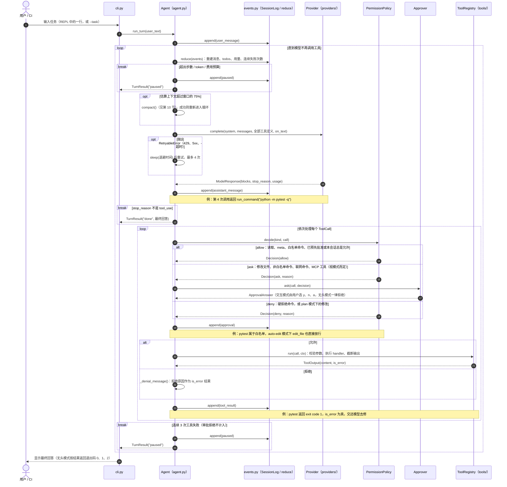
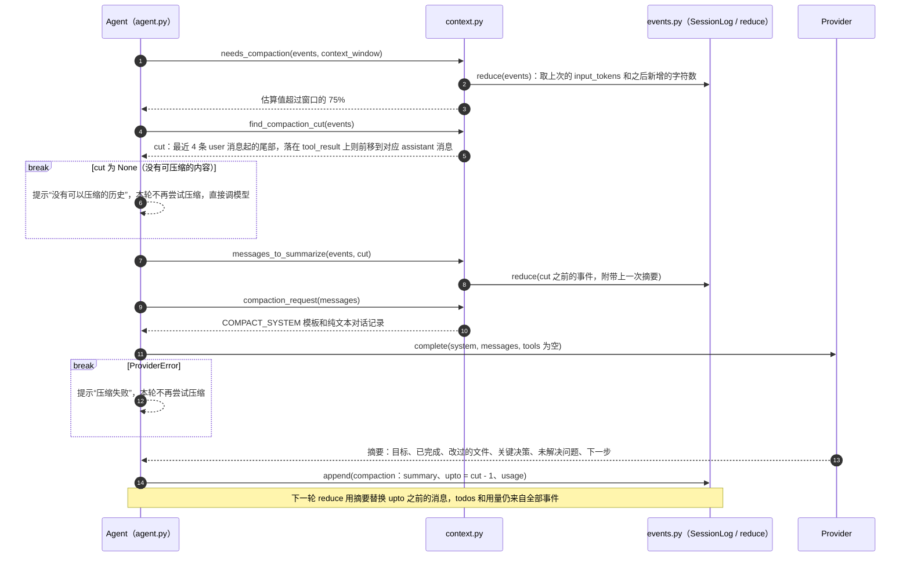
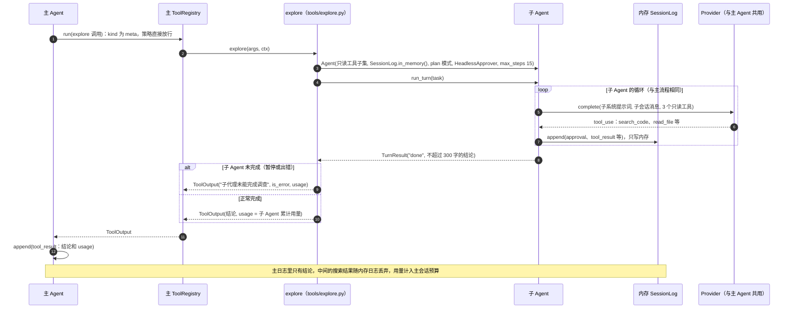
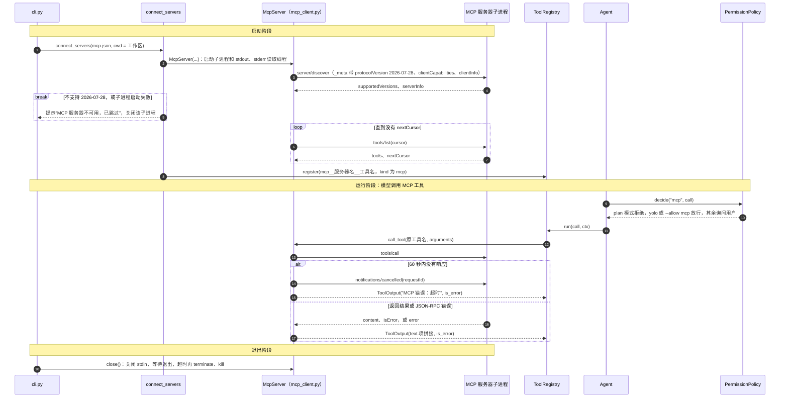
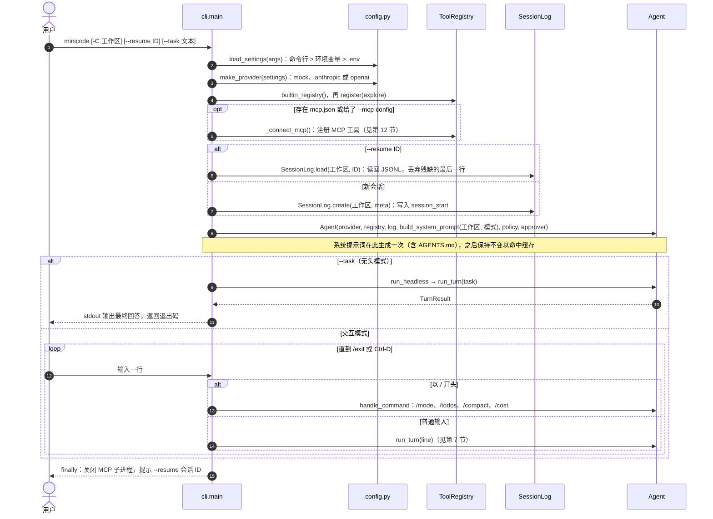

# minicode 设计文档

minicode 是一个运行在终端里的编程 Agent，能读代码、搜代码、改代码、跑命令，并在权限策略和人工审批的约束下完成任务。它是文章《[如何设计和开发一款高效实用的 Agent：理论、原则与代码](https://yishui.pages.dev/#/e077cfd49ac75efabd60dca729248876)》的参考实现：文章讲“为什么这样设计”，本文档讲“具体做什么、怎么做”。

本文档记录功能范围、架构和每个模块的实现约定，是实现与评审的依据。

## 1. 目标与非目标

### 用户故事

1. 作为开发者，我在终端里说“修复失败的测试”，Agent 自己找到问题、改代码、跑测试验证，改文件前先问我。
2. 我想先看方案再动手：切到只读的 plan 模式，让它只调查、只出方案。
3. 我在 CI 里用 `--task` 无头运行，用退出码判断结果；没人审批的操作一律拒绝，不会卡住。
4. 任务做到一半我按了 Ctrl-C，或者进程被杀，之后 `--resume` 能接着做。
5. 团队有内部工具，用 MCP 接进来，不用改 Agent 代码。

### 目标

- **交互式 CLI**：在终端里多轮对话完成编程任务，模型文本流式输出，工具调用与审批实时可见。
- **无头模式**：`--task "..."` 一次性执行任务后退出，退出码表示结果，可接入 CI 与评测。
- **可恢复**：会话以 JSONL 事件日志持久化，`--resume <id>` 从中断处继续。
- **可控**：工作区路径限制、分级审批、硬拒绝清单、四种运行模式、预算护栏。
- **多模型**：中立消息模型 + Anthropic / OpenAI 兼容 / Mock 三个适配器；默认 Mock，无需 API Key 即可完整演示与测试。
- **上下文工程**：AGENTS.md 项目指令、按需检索、工具输出截断、自动压缩、todo 清单、只读探索子代理。
- **MCP**：最小 stdio MCP 客户端（只支持 2026-07-28 版规范），把外部工具并入工具注册表。

### 非目标

| 不做 | 理由 |
| --- | --- |
| 使用 LangChain 等 Agent 框架 | 循环、工具、状态要自己掌控，出问题才能查到底 |
| 可写、可并行的多代理 | 多个代理同时改一个仓库，需要冲突合并和 worktree 隔离，复杂度暴涨 |
| 向量索引 | 代码有结构，grep 加按需读取更准、更新也及时 |
| 内置 Docker 沙箱 | 会提高上手门槛；README 给出在容器中运行的方法 |
| 评测框架 | 评测方法写在文章中；仓库只包含 pytest 单元测试 |
| MCP 旧版 `initialize` 握手、资源、提示词、Sampling、Elicitation、Roots | 只用工具；新规范已弃用 Sampling 与 Roots |

### 默认模型

- Anthropic：`claude-sonnet-5-5`；OpenAI 兼容：`gpt-5.6-terra`。窗口与单价见 `config.py`（2026-10 按厂商文档核实）。
- 不默认使用 GPT-6 系列：它们只支持经 Responses API 调用工具，而本项目的 OpenAI 适配器走 Chat Completions，以兼容 DeepSeek、通义千问、Ollama、vLLM 等更多服务。

## 2. 技术栈与工程约定

- Python ≥ 3.12，uv 管理，src 布局，构建后端 `uv_build`（与 llm-gateway-demo 一致）。
- 运行依赖：`anthropic`、`openai`、`pydantic`、`rich`。开发依赖：`pytest`。不引入其他依赖。
- 包名 `minicode`，命令行入口 `minicode = "minicode.cli:main"`。
- 文档、docstring、注释使用中文；标识符英文。模块 docstring 说明它对应文章的哪一节、遵循哪条原则。
- 所有测试离线运行，不访问网络，不需要 API Key。

## 3. 目录结构

```text
coding-agent-demo/
├── AGENTS.md                  # 本仓库自己的项目指令（给在本仓库工作的 Agent 看）
├── README.md
├── .env.example
├── pyproject.toml
├── docs/design.md
├── examples/
│   ├── buggy-calc/            # 带 bug 的示例项目：calc.py、test_calc.py、AGENTS.md
│   ├── mock_scripts/
│   │   └── fix_buggy_calc.json  # Mock 模型的回放脚本：修复 buggy-calc
│   ├── toy_mcp_server.py      # 玩具 MCP 服务器（stdio，2026-07-28）
│   └── mcp.json               # MCP 配置示例
├── src/minicode/
│   ├── __init__.py
│   ├── cli.py                 # 参数解析、交互式 REPL、无头模式
│   ├── config.py              # 配置：环境变量 / .env / 命令行；模型窗口与单价表
│   ├── messages.py            # 中立消息模型
│   ├── events.py              # 事件类型、JSONL 会话日志、归约器
│   ├── agent.py               # Agent 循环：调用模型、审批、执行工具、预算、重试
│   ├── permissions.py         # 运行模式、路径守卫、命令分类、审批决策
│   ├── context.py             # 系统提示词、AGENTS.md、token 估算、自动压缩
│   ├── mcp_client.py          # stdio MCP 客户端
│   ├── ui.py                  # rich 渲染、审批提示（可替换为无头实现）
│   ├── providers/
│   │   ├── base.py            # Provider 协议、错误类型
│   │   ├── anthropic.py
│   │   ├── openai_compat.py
│   │   └── mock.py
│   └── tools/
│       ├── base.py            # Tool、ToolRegistry、ToolOutput、截断
│       ├── files.py           # read_file、list_files、edit_file、create_file
│       ├── search.py          # search_code
│       ├── shell.py           # run_command
│       ├── todos.py           # update_todos
│       └── explore.py         # explore 子代理
└── tests/
```

### 业务流程图索引

| 流程 | 所在章节 | 内容 |
| --- | --- | --- |
| 一次输入的完整一轮（主流程） | 第 7 节 | `run_turn`：预算 → 压缩 → 调模型 → 决策、审批、执行、记录 |
| 中断处理 | 第 7 节（表格） | Ctrl-C 或进程被杀时，怎样保持 tool_use 与 tool_result 配对 |
| 自动压缩 | 第 10 节 | 选切分点 → 模型写摘要 → 追加 compaction 事件 |
| explore 子代理 | 第 11 节 | 独立的只读 Agent 在内存日志里跑完，只把结论交回主 Agent |
| MCP 连接与调用 | 第 12 节 | `server/discover` → `tools/list` → 审批 → `tools/call` |
| 启动与恢复 | 第 13 节 | 组装对象、`--resume` 读回日志、REPL 与无头模式 |

图中的参与者和箭头上的名字都是真实的类名和函数名，每张图下面附有“步骤 → 代码位置”对照表。标着“例”的注释，对应 `examples/mock_scripts/fix_buggy_calc.json` 这条修复 buggy-calc 的轨迹，可以离线运行并对照 `.minicode/sessions/` 下的 JSONL 日志。

## 4. 中立消息模型（messages.py）

用 pydantic 定义，与任何厂商协议无关：

- `TextBlock(text)`、`ToolCall(id, name, arguments: dict)`、`ToolResult(call_id, content: str, is_error: bool)`。
- `Message(role: "user" | "assistant", blocks: list[TextBlock | ToolCall | ToolResult])`。工具结果放在 user 消息里（与 Anthropic 一致，OpenAI 适配器负责转换）。
- `Usage(input_tokens, output_tokens, cache_read_tokens=0)`。
- `ModelResponse(blocks, stop_reason: "end_turn" | "tool_use" | "max_tokens" | "refusal", usage)`；`tool_calls` 与 `text` 为便捷属性。
- `ToolSpec(name, description, input_schema)`：发给模型的工具定义。

## 5. 模型适配器（providers/）

```python
class Provider(Protocol):
    model: str

    def complete(
        self,
        *,
        system: str,
        messages: list[Message],
        tools: list[ToolSpec],
        max_tokens: int,
        on_text: Callable[[str], None] | None = None,
    ) -> ModelResponse: ...
```

- 错误分两类：`RetryableError(retry_after: float | None)`（429、5xx、超时、连接错误）和 `ProviderError`（其余，不重试）。重试在 agent 层统一做，适配器不重试（SDK 自带重试设为 0）。
- **anthropic.py**：Messages API，流式（`messages.stream`），`on_text` 逐段回调。转换：`ToolCall` ↔ `tool_use` 块（`input` 是对象）；`ToolResult` → user 消息里的 `tool_result` 块（`is_error`）。系统提示词与最后一个工具定义加 `cache_control: {"type": "ephemeral"}` 以命中提示词缓存。`stop_reason` 映射：`tool_use`、`end_turn`/`stop_sequence` → `end_turn`、`max_tokens`、`refusal`；`pause_turn` 视为 `end_turn`（不使用服务端工具）。
- **openai_compat.py**：Chat Completions（兼容 OpenAI、DeepSeek、Qwen、Ollama、vLLM），`base_url` 可配置，流式。转换：`ToolCall` ↔ `tool_calls`（`arguments` 是 **JSON 字符串**，解析失败时把原文放进 `{"_raw": ...}` 并由工具层报参数错误）；`ToolResult` → 独立的 `role: "tool"` 消息（`tool_call_id`），`is_error` 时在内容前加 `ERROR: `；同一条 user 消息里的文本块放在 tool 消息之后；助手消息没有文本时，带 tool_calls 则 `content` 为 null，否则为空字符串（null 会被接口拒绝）。流式时按 `index` 累积 `tool_calls` 的增量。`finish_reason` 映射：`tool_calls` → `tool_use`、`length` → `max_tokens`、`content_filter` → `refusal`、其余 → `end_turn`。

两家协议的主要差异（全部收敛在适配器里，循环只看中立消息）：

| 差异点 | Anthropic Messages | OpenAI 兼容 Chat Completions |
| --- | --- | --- |
| 调用参数 | `input` 是对象 | `arguments` 是 JSON 字符串，要解析，并处理解析失败 |
| 工具结果 | user 消息里的 `tool_result` 块 | 独立的 `role: tool` 消息 |
| 错误结果 | `is_error: true` | 没有该字段，用内容前缀 `ERROR: ` 标明 |
| 是否要调工具 | `stop_reason` 为 `tool_use` | `finish_reason` 为 `tool_calls` |
| 流式工具调用 | 内容块事件 | 按 `index` 累积参数增量 |

- 两个适配器都把“请求体构造”和“响应解析”写成纯函数（如 `to_anthropic_messages`、`from_openai_message`），以便离线单元测试。
- **mock.py**：`ScriptedProvider`，从 JSON 脚本按顺序回放响应，不看输入；脚本项格式：`{"text": "...", "tool_calls": [{"name": "...", "arguments": {...}}]}`，`id` 自动生成；脚本耗尽时返回 `end_turn` 文本“（Mock 脚本已结束）”。另提供 `compact` 用途：当 `complete` 以 `tools=[]` 且系统提示词以压缩标记开头时，不消耗脚本，返回根据消息确定性生成的摘要。usage 按字符数 / 4 估算。`on_text` 按词流式输出。

## 6. 事件日志与归约器（events.py）

会话 = 只追加的事件列表，存为 `<workspace>/.minicode/sessions/<session_id>.jsonl`，每行一个事件 `{"type", "ts", ...}`。

| 事件 | 字段 |
| --- | --- |
| `session_start` | session_id、workspace、provider、model、mode |
| `user_message` | text |
| `assistant_message` | blocks、stop_reason、usage |
| `approval` | call_id、tool、decision（allow / deny）、by（policy / user / headless）、reason |
| `tool_result` | call_id、content、is_error、usage（可选：工具内部调用模型的用量，如 explore 子代理） |
| `todos_updated` | todos |
| `compaction` | summary、upto（被摘要替换的最后一个事件下标）、usage（压缩调用的用量） |
| `interrupted` | reason |
| `paused` | reason（budget / consecutive_failures / max_steps） |

`reduce(events) -> SessionState`（纯函数）：

- `messages`：按事件重建中立消息；相邻的 `tool_result` 合并为同一条 user 消息；遇到 `compaction` 时，丢弃 `upto` 之前的消息，以一条内容为“【此前对话的摘要】…”的 user 消息开头。
- `todos`、累计 `usage`（含 tool_result 与 compaction 中的旁路用量，只计入预算，不参与上下文大小估算）、`steps`（assistant_message 数）、`consecutive_failures`。
- 不变式：每个 `ToolCall` 后都有对应的 `ToolResult`。归约时如发现悬空的工具调用（例如进程被杀），补一条 `is_error=True`、内容为“操作已中断，未执行”的结果。

`SessionLog`：`create(workspace, meta)`、`load(workspace, session_id)`、`append(event)`（追加后立即 flush）。

## 7. Agent 循环（agent.py）

```text
run_turn(user_text):
    log user_message
    while True:
        state = reduce(events)
        if 超出预算（步数 / token / 费用）: log paused; return
        if 估算上下文 > 窗口 × 0.75: compact(); continue
        resp = 带重试地调用 provider.complete(system, state.messages, registry.specs())
        log assistant_message
        if resp.stop_reason != "tool_use": return resp.text
        for call in resp.tool_calls:
            decision = policy.decide(call)           # allow / ask / deny
            if ask: decision = approver.ask(call)     # 无头模式 → deny
            log approval
            output = registry.run(call) if allow else 拒绝说明（is_error）
            log tool_result
        if 连续失败 ≥ 3: log paused; return
```

- **工具定义始终全部发送**（不随模式增减），模式只在执行时生效，保证工具列表稳定、提示词缓存可命中。
- **重试**：`RetryableError` 指数退避，`base=1s`、最多 4 次重试、上限 30s、加随机抖动；优先使用 `retry_after`。
- **中断**：调用模型或执行工具时捕获 `KeyboardInterrupt`，为尚未有结果的工具调用补“用户已取消”结果，记 `interrupted`，回到 REPL；不退出进程。
- **连续失败**：工具结果 `is_error` 连续 3 次（审批拒绝不计入）则暂停，提示用户介入。
- **预算**：`max_steps`（默认 50）、`max_tokens_total`（默认不限）、`max_cost_usd`（按 config 中的单价估算，未知模型只按 token）。
- 循环与 UI 解耦：通过 `AgentEvents` 回调（on_text、on_tool_call、on_tool_result、on_todos、on_notice）通知界面。

### 序列图：一次输入的完整一轮



| 步骤 | 代码位置 | 说明 |
| --- | --- | --- |
| 1–2 | `cli.py` 的 `run_repl` / `run_headless` → `Agent.run_turn` | REPL 中以 `/` 开头的输入由 `handle_command` 处理，不进入 `run_turn` |
| 3、5、11、19、23、24 | `Agent._record` → `SessionLog.append` | 每个事件追加一行 JSONL 并立即 flush，进程随时被杀也不丢已发生的事件 |
| 4 | `Agent.state` 属性 → `events.reduce` | 每一轮都从完整事件列表重新归约，没有其他内存状态 |
| 5–6 | `Agent._check_budget` → `Agent._pause` | 步数按本轮计；token 与费用按整个会话计，含 explore 子代理和压缩的用量 |
| 7 | `context.needs_compaction` → `Agent.compact` | 每次调用模型前最多压缩一次，避免压缩无效时死循环 |
| 8–10 | `Agent._call_model` → `Provider.complete`；`RetryPolicy.delay` | 工具定义始终全部发送，模式只在执行时生效；文本经 `on_text` 流式显示 |
| 12 | `run_turn` 中对 `stop_reason` 的判断 | `max_tokens` 截断时额外提示“回答可能不完整” |
| 13–18 | `Agent._approve` → `PermissionPolicy.decide` → `InteractiveApprover.ask` / `HeadlessApprover.ask` | 用户选“总是允许”时调用 `PermissionPolicy.remember`；联网命令不能被记住 |
| 20–21 | `ToolRegistry.run` → `Tool.handler` | 未知工具不经审批，直接返回“未知工具”错误；handler 抛出的异常都转成 `is_error` 结果 |
| 22 | `agent._denial_message` | 用户拒绝时附上用户给的理由，让模型据此调整方案 |
| 24–25 | `MAX_CONSECUTIVE_FAILURES = 3` | 计数由 `reduce` 维护：成功结果或新的用户输入会清零 |
| 26 | `cli.run_headless` 的 `EXIT_CODES` | 0 = 完成，2 = 暂停，其余（错误、中断）为 1 |

### 中断处理

中断可能发生在主流程的任何一步，所以不画进序列图，单独说明：

| 中断发生在 | 代码怎么处理 | 日志里留下什么 | 之后怎样继续 |
| --- | --- | --- | --- |
| 调用模型时（步骤 8–10） | `run_turn` 捕获 `KeyboardInterrupt`，调用 `_interrupted` | 一条 `interrupted`；这次调用没有 `assistant_message` | 历史停在上一条消息，直接输入新指示即可 |
| 执行工具时（步骤 13–23） | 为本批尚未写入结果的调用补一条 `CANCELLED_RESULT`（“用户已取消，未执行”，`is_error`），再调用 `_interrupted` | 补齐的 `tool_result` 加一条 `interrupted` | 每个 tool_use 都有配对结果，历史合法 |
| explore 子代理运行时 | 子代理的 `run_turn` 返回 interrupted 后，explore 重新抛出 `KeyboardInterrupt` | 按“执行工具时”处理 | 同上 |
| 进程被杀（任何时刻） | 代码来不及处理 | 日志停在最后一行；最后一行残缺时，`SessionLog.load` 丢弃它 | `--resume` 后，`reduce` 的 `close_dangling` 为悬空调用补“操作已中断，未执行” |
| REPL 等待输入时 | `run_repl` 提示用 `/exit` 或 Ctrl-D 退出 | 无 | 不受影响 |

## 8. 工具（tools/）

`Tool(name, description, input_schema, handler, kind)`，`kind ∈ {read, edit, exec, meta, mcp}`，由权限策略使用。`handler(args, ctx) -> ToolOutput(content, is_error)`；`ctx` 含 workspace、路径守卫、会话状态回调。`ToolRegistry.run` 负责：未知工具 → 错误；按 `input_schema` 做必填与类型的轻量校验 → 错误说明；异常 → 错误（不抛出）；最后统一截断。

统一截断：结果超过 `max_output_chars`（默认 20000）时保留头 70%、尾 30%，中间写“…已省略 N 个字符；可用 offset/limit 或更精确的 pattern 缩小范围…”。

| 工具 | 参数 | 要点 |
| --- | --- | --- |
| `read_file` | path、offset=1、limit=400 | 输出带行号（`{n:>6}\t`）；末尾提示“显示第 a–b 行，共 N 行；继续读请用 offset=b+1”；二进制文件拒绝 |
| `list_files` | pattern="**/*"、path="." | git 仓库内用 `git ls-files --cached --others --exclude-standard`，否则遍历并忽略 .git、.venv、node_modules、__pycache__、.minicode；最多 500 条，超出时提示用更窄的 pattern |
| `search_code` | pattern、path="."、glob、case_insensitive=false | 有 `rg` 用 rg，否则 Python 正则遍历；输出 `path:line:text`；最多 100 条，超出提示缩小范围 |
| `edit_file` | path、old_str、new_str、replace_all=false | old_str 必须存在；不唯一且未设 replace_all 时报错并列出所有匹配的行号；old_str == new_str 报错；成功后返回修改处前后 3 行带行号的片段 |
| `create_file` | path、content、overwrite=false | 已存在且未设 overwrite 时报错并提示改用 edit_file；自动创建父目录 |
| `run_command` | command、timeout_sec=120（≤600） | `bash -c` 在 workspace 中执行；返回 exit code、stdout、stderr（各自截断）；超时则杀进程组并报错 |
| `update_todos` | todos: [{content, status}] | status ∈ pending / in_progress / done；整体替换；最多一个 in_progress；记 `todos_updated` 事件 |
| `explore` | task | 见第 11 节 |

工具描述要写清“何时用、何时不用、返回什么”（例如 read_file 提示先用 search_code 定位；edit_file 提示先 read_file 确认上下文、old_str 要包含足够上下文以唯一匹配）。

## 9. 权限（permissions.py）

### 路径守卫

`resolve_in_workspace(path) -> Path`：相对路径基于 workspace；`Path.resolve()` 解析符号链接后必须 `is_relative_to(workspace.resolve())`，否则抛 `PermissionError("路径超出工作区")`。文件类工具全部经过它。

### 命令分类

`classify_command(cmd, workspace) -> "deny" | "network" | "safe" | "other"`：

先切分、再归一化，再判断：

- **切分**：按 `|`、`||`、`&&`、`&`、`;`、换行、`(`、`)`、`$(`、反引号切成片段，逐段判断，整条命令取最危险的结果。
- **归一化**：剥掉开头的环境变量赋值和包装命令（`env`、`command`、`exec`、`nohup`、`time`、`nice`、`timeout`、`xargs`、`stdbuf` 及其选项）；`git` 去掉子命令前的全局选项（`-C X`、`-c k=v`、`--no-pager`、`--git-dir=…` 等）；`sh/bash/zsh/dash -c "…"` 与 `eval …` 递归检查其中的命令（嵌套超过 3 层按 deny 处理）。

分类：

- **deny**（任何模式都拒绝）：`rm -rf /`、`rm -rf ~`、`rm -rf *` 等对根或家目录的递归删除；`curl|wget ... | sh/bash`；`git push` 带 `-f`、`--force*` 或 `+refspec`；`mkfs`、`dd of=/dev/`；fork 炸弹；`sudo`。
- **network**（总是需要用户审批）：任一片段是 curl、wget、ssh、scp、rsync、nc、`git push/pull/fetch/clone`、`pip/uv/npm/pnpm/yarn install|add`、`uv sync`。
- **safe**（白名单，可自动放行）：同时满足
  - 不含 shell 元字符（`; & | > < $ \``、换行、`$(`）；
  - 命令属于：`pytest`、`python -m pytest`、`uv run pytest`、`git status/diff/log/show/branch`、`ls`、`pwd`、`rg`、`grep`、`head`、`tail`、`wc`、`cat`；
  - 不带能执行程序或写文件的参数：`rg --pre/-z/--search-zip/--hostname-bin`，`git --output/--ext-diff/--textconv`；`git branch` 只允许列出分支的参数；
  - 每个非选项参数按路径解析（展开符号链接）后都在工作区内。
- 其余为 **other**。

### 运行模式与决策矩阵

| 模式 | 适用场景 | 行为概要 |
| --- | --- | --- |
| plan | 先看方案 | 只读；任何修改和非白名单命令都拒绝 |
| default | 日常使用 | 改文件、跑非白名单命令前都询问 |
| auto-edit | 信任它改代码 | 改文件自动放行，命令仍要询问 |
| yolo | 在容器里放手干 | 除硬拒绝和联网命令外全部放行 |

具体决策：

| kind / 类别 | plan | default | auto-edit | yolo |
| --- | --- | --- | --- | --- |
| read、meta（含 explore、update_todos） | allow | allow | allow | allow |
| edit（edit_file、create_file） | deny | ask | allow | allow |
| exec：safe | allow | allow | allow | allow |
| exec：other | deny | ask | ask | allow |
| exec：network | deny | ask | ask | ask |
| exec：deny | deny | deny | deny | deny |
| mcp | deny | ask | ask | allow |

- `ask` 时交互模式下用户可选：`y` 允许一次 / `n` 拒绝（可附一句理由，回传给模型）/ `a` 本会话内总是允许（edit 类按工具名记住；exec 按命令的第一个词记住，network 类不可“总是允许”）。
- 无头模式下 `ask` 一律视为 `deny`，除非命令行给了 `--allow edit`、`--allow exec`（不含 network）或 `--allow mcp`。
- 被拒绝时回传给模型的结果：`is_error=True`，内容说明拒绝原因与可行替代（例如“当前为 plan 模式，只能读取；请先给出修改计划”）。

## 10. 上下文工程（context.py）

- **系统提示词**：角色与工作方式（先探索再修改、修改后运行测试验证、多步任务用 update_todos、大范围探索交给 explore、不确定时提问）；工作区路径、操作系统、当前日期、运行模式；若 workspace 根目录有 `AGENTS.md`，原样附在末尾（上限 8000 字符）。系统提示词在会话内保持不变，以利于缓存（todo 等动态信息不放进系统提示词）。
- **token 估算**：优先用上一次响应的 `usage.input_tokens`，加上之后新增消息按“字符数 / 4”估算。
- **自动压缩**：估算值超过 `context_window × 0.75` 时触发。保留最近 4 条 user 消息起的尾部（切分点落在一条真实用户输入或一条 assistant 消息之前；若落在 tool_result 上，就前移到发出这些调用的 assistant 消息，保证不拆开 tool_use 与 tool_result），其余交给模型按固定模板总结：任务目标、已完成、修改过的文件、关键决策与发现、未解决问题、下一步。写入 `compaction` 事件。todos 由归约器独立保存，不依赖摘要。
- 每个模型的 `context_window` 在 config 中配置；Mock 默认 8000，便于测试压缩。

### 序列图：自动压缩



| 步骤 | 代码位置 | 说明 |
| --- | --- | --- |
| 1–3 | `context.needs_compaction` → `estimate_context_tokens` | 上次响应的 `input_tokens` 最准，新增部分按“字符数 / 4”粗估 |
| 4–5 | `context.find_compaction_cut` | 只在最后一次压缩之后的窗口里找切分点 |
| 6 | `Agent.compact` 返回 False | `run_turn` 用 `just_compacted` 标记本轮已尝试过，避免压缩无效时死循环 |
| 7–10 | `messages_to_summarize`、`compaction_request`、`render_transcript` | 对话渲染成纯文本，不带工具定义，避免协议约束；每条工具结果最多取 2000 字符 |
| 11–13 | `Agent.compact` → `Provider.complete` | 压缩失败同样返回 False；Mock 模型能识别压缩请求，按消息生成确定性摘要，不消耗回放脚本 |
| 14 | `Agent._record("compaction", ...)` | 原始事件仍留在日志里，压缩只是追加一条事件 |

## 11. explore 子代理（tools/explore.py）

- 参数 `task`：要调查的问题。
- 新建一个**独立的** `Agent`：同一个 provider，工具只有 read_file、list_files、search_code，系统提示词要求“只调查不修改，最后用不超过 300 字总结结论和关键文件位置”，`max_steps=15`，事件写入内存，不落主会话日志。
- 只把子代理的最终文本作为工具结果返回给主 Agent，中间的搜索结果不进入主上下文。

### 序列图：explore 子代理



| 步骤 | 代码位置 | 说明 |
| --- | --- | --- |
| 1–2 | `ToolRegistry.run` → `make_explore_tool` 中的 `explore` | 由 `cli.main` 在启动时注册，和内置工具共用一个注册表 |
| 3 | `registry.subset(EXPLORE_TOOLS)`、`EXPLORE_SYSTEM_PROMPT` | plan 模式加只读工具，子 Agent 即使想改文件也会被拒绝 |
| 4–8 | `Agent.run_turn`（子 Agent） | 完全复用主流程，只是日志在内存里 |
| 9–11 | `explore` 的返回值 | 子 Agent 被中断时重新抛出 `KeyboardInterrupt`，由主 Agent 按中断处理 |
| 12 | `Agent._execute` 记录 `tool_result` 时带上 `usage` | `reduce` 把这部分用量计入预算，但不算主上下文的大小 |

## 12. MCP 客户端（mcp_client.py）

只实现 2026-07-28 版规范中工具相关的最小子集，传输为 stdio：子进程的 stdin/stdout 按行收发 JSON-RPC 2.0 消息，stderr 透传到日志。

- 实现前必须查阅官方规范确认字段名：`https://modelcontextprotocol.io/specification/2026-07-28/`（changelog、basic、server/discover、server/tools、transports/stdio，均可在 URL 后加 `.md` 获取 Markdown）。
- 每个请求在 `params._meta` 中携带协议版本与客户端能力（具体键名以规范为准）。
- 启动后调用 `server/discover` 校验服务器支持 `2026-07-28`，否则报错并跳过该服务器；然后 `tools/list`（处理分页游标），对每个工具注册 `mcp__<server>__<tool>`（kind=mcp），描述前加“[MCP:<server>]”。
- `tools/call` 的结果：把 `content` 中的 text 项拼接为字符串；`isError` 映射为 `is_error`；JSON-RPC 错误映射为 `is_error` 结果。
- 请求超时 60 秒；进程退出时清理子进程。
- 配置文件：`<workspace>/.minicode/mcp.json` 或 `--mcp-config`，格式 `{"servers": {"<name>": {"command": "...", "args": [...], "env": {...}}}}`。
- `examples/toy_mcp_server.py`：零依赖，实现 `server/discover`、`tools/list`、`tools/call`，提供 `word_count(text)` 和 `utc_now()` 两个工具，用于演示与测试。

### 序列图：MCP 连接与调用



| 步骤 | 代码位置 | 说明 |
| --- | --- | --- |
| 1–2 | `cli._connect_mcp` → `mcp_client.connect_servers` → `McpServer.__init__` | 子进程以工作区为当前目录启动，配置里的相对路径相对于工作区；stderr 写入 `.minicode/mcp-stderr.log` |
| 3–5 | `McpServer.discover` → `McpServer.request` | 每个请求都在 `params._meta` 里带协议版本和能力，无握手；不支持该版本时报错码 `-32022` |
| 6–7 | `McpServer.list_tools` | 按 `nextCursor` 翻页 |
| 8 | `mcp_client.make_mcp_tool`、`tool_name` | 名称里模型 API 不接受的字符替换为下划线 |
| 9–10 | `PermissionPolicy.decide`（矩阵的 mcp 列） | 外部工具的行为无法审计，默认需要审批 |
| 11–17 | `make_mcp_tool` 的 handler → `McpServer.call_tool` | 超时和 JSON-RPC 错误都转成 `is_error` 结果，不会打断 Agent 循环 |
| 18 | `cli.main` 的 `finally` → `McpServer.close` | 不管正常退出还是出错，都会清理子进程 |

## 13. CLI（cli.py、ui.py）

```text
minicode [-C WORKSPACE] [--provider mock|anthropic|openai] [--model MODEL]
         [--mode plan|default|auto-edit|yolo] [--task TEXT] [--resume SESSION_ID]
         [--allow edit|exec|mcp ...] [--max-steps N] [--max-cost-usd X]
         [--mock-script PATH] [--mcp-config PATH]
```

- 交互模式：rich 渲染模型文本（流式）、工具调用摘要（工具名 + 关键参数）、工具结果首行、todo 清单、审批提示。斜杠命令：`/mode <m>`、`/todos`、`/compact`、`/cost`、`/exit`。
- 无头模式：`--task` 执行一轮后退出；退出码 0 = 正常结束，2 = 暂停（预算 / 连续失败），1 = 错误。输出最终回答到 stdout，过程到 stderr。
- 启动时打印 session id，退出时提示 `--resume <id>`。
- 配置优先级：命令行 > 环境变量 > `.env`。环境变量：`MINICODE_PROVIDER`、`MINICODE_MODEL`、`ANTHROPIC_API_KEY`、`OPENAI_API_KEY`、`OPENAI_BASE_URL`。

### 序列图：启动与恢复



| 步骤 | 代码位置 | 说明 |
| --- | --- | --- |
| 1–3 | `cli.main` → `config.load_settings`、`make_provider` | 配置错误或工作区不存在时直接返回退出码 1 |
| 4–5 | `tools.builtin_registry`、`make_explore_tool`、`cli._connect_mcp` | 工具集在会话开始时确定，之后不再变化 |
| 6–7 | `SessionLog.load` / `SessionLog.create` | 恢复时不重写 `session_start`；第一轮 `reduce` 会为悬空调用补上结果 |
| 8 | `Agent(...)`、`context.build_system_prompt` | 无头模式用 `HeadlessApprover`，交互模式用 `InteractiveApprover`；`--allow` 写进 `PermissionPolicy.preapproved` |
| 9–11 | `cli.run_headless` | 退出码见第 7 节步骤 26 |
| 12–14 | `cli.run_repl`、`cli.handle_command` | `/mode` 只改 `PermissionPolicy.mode`，不改系统提示词 |
| 15 | `cli.main` 的 `finally` | 正常退出、出错或中断都会执行 |

## 14. 测试计划（tests/）

全部离线，用 Mock 或纯函数：

- `test_permissions.py`：路径越界（`..`、绝对路径、指向外部的符号链接）；命令分类各类样例（含白名单命令参数越界）；模式决策矩阵；“总是允许”记忆；无头 `--allow`。
- `test_tools.py`：read_file 分页与提示；list_files 忽略规则与上限；search_code（强制走 Python 回退分支也要测）；edit_file 的不存在 / 不唯一 / 相同 / replace_all / 成功片段；create_file 覆盖保护；run_command 退出码、超时、截断。
- `test_events.py`：JSONL 往返；归约器重建消息、合并 tool_result、压缩替换、悬空工具调用补结果；resume 后继续对话。
- `test_agent.py`：用 `fix_buggy_calc.json` 在 buggy-calc 的临时副本上端到端运行（auto-edit 模式，自动允许 pytest），结束后真实 pytest 通过；拒绝审批时模型收到 is_error；连续 3 次失败暂停；max_steps 暂停；可重试错误按退避重试后成功（用可注入的 sleep）；中断后 tool_use/tool_result 配对。
- `test_context.py`：系统提示词包含 AGENTS.md；超过阈值触发压缩且切分点合法；压缩后 todos 仍在。
- `test_providers.py`：两个适配器的请求构造与响应解析（用手写的响应样例，不发网络请求），包括 OpenAI `arguments` 字符串解析失败、`tool` 角色消息顺序、Anthropic `is_error` 与 cache_control。
- `test_explore.py`：子代理只能用只读工具，主会话日志里只有最终摘要。
- `test_mcp.py`：启动 `toy_mcp_server.py` 子进程，完成 discover / list / call，工具以 `mcp__toy__word_count` 注册并可调用；服务器报错映射为 is_error。

## 15. 审查记录：发现过的权限绕过

以下问题都在代码审查中发现、已修复，并在 `tests/test_permissions.py` 中有对应用例：

| 绕过方式 | 原因 | 修复 |
| --- | --- | --- |
| `cat /etc/hosts`、经仓库内符号链接读外部文件 | 白名单只看命令名，不检查参数 | 每个非选项参数按路径解析（展开符号链接），越界即降级为 other |
| `rg --pre rm x`（plan 模式下也被放行）、`git diff --output=…` | 白名单命令的某些选项能执行程序或写文件 | 这类选项出现即降级为 other；`git branch` 只允许列出分支 |
| `true & sudo rm -rf /`、`(sudo reboot)`、`echo $(curl …)` | 只按 `\|`、`&&`、`;` 切分 | 按 `&`、子 shell、命令替换切分 |
| `env curl …`、`timeout 5 sudo …`、`xargs sudo …` | 只看片段首词 | 剥掉包装命令后再判断 |
| `git -C . push --force`、`git push origin +main` | git 全局选项、`+refspec` 未处理 | 去掉全局选项；`+refspec` 与 `--force*` 都视为强推 |
| `bash -c "sudo …"`、`eval curl …` | 未检查内层命令 | 递归检查（超过 3 层按 deny） |
| explore 子代理、压缩的 token 不计入预算 | 只统计主循环的模型调用 | 用量写入 `tool_result` / `compaction` 事件，只计入预算 |
